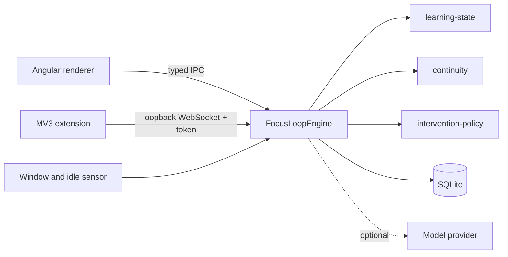

<p align="center">
  <picture>
    <source media="(prefers-color-scheme: dark)" srcset="docs/assets/logo_name_dark.png" />
    <source media="(prefers-color-scheme: light)" srcset="docs/assets/logo_name_light.png" />
    
  </picture>
</p>

<p align="center"><b>English</b> · <a href="README.zh-CN.md">简体中文</a></p>

# FocusLoop

**Get back to exactly where you were thinking.** A local-first desktop agent that helps people who
struggle with attention and task initiation recover from interruptions during study.

[Install](#install) · [Quick start](#quick-start) · [How it works](#how-it-works) · [Docs](#documentation) · [Contributing](#contributing)

> v0.1 demo · Electron + Angular desktop · optional MV3 browser extension · all data stays on your machine.

FocusLoop does **not** diagnose ADHD or model clinical severity. It watches the _learning
interaction_ (started? still here? where was the thought?) and, instead of nagging you to "stay
focused", hands you a **Resume Card**: what you were doing, what you finished, what is open, and the
next step.

## Features

- **Micro tasks** — turn a course, or your own `.txt` / `.md` notes, into 3–5 tasks of a few minutes each.
- **Focus sessions with live checkpoints** — the current concept, goal, what is mastered, what is unresolved, and the next best action are saved continuously.
- **Interruption detection** — an 8-state, rule-based engine notices a lost window or an idle gap; nothing pops up while you are away.
- **Resume Card** — on return, shows the exact cognitive position and records resume latency and whether the nudge helped.
- **Insights & Dashboard** — time by learning state, daily activity, per-course breakdown, interruptions, resume latency and intervention outcomes, over a session, today, 7 days or all time.
- **Bring your own model, or none** — runs fully offline on a deterministic mock provider; optionally use DeepSeek, OpenAI or any OpenAI-compatible endpoint.
- **Bilingual, themeable** — English and Simplified Chinese; light, dark or follow the OS.

## Install

Download `FocusLoop-Setup.exe` from the [releases page](https://github.com/nianpingy-cpu/focusloop/releases)
(verify it against `SHA256SUMS.txt`). No Node.js or pnpm is needed. For macOS or other builds, see the
[development guide](docs/development.md#package).

## Quick start

From source (Node.js ≥ 22.13, pnpm ≥ 9):

```bash
corepack enable
pnpm install
pnpm --filter @focusloop/desktop run start
```

Then try the loop: **Home** → _Start session_ on “Red-black trees: the basics” → complete the first
micro task → switch to another window for ~20 seconds → come back to the Resume Card.

No extension, API key or network is required. Running, packaging, launchers and model setup are in the
[development guide](docs/development.md).

## How it works



Four invariants:

1. **Local-first.** No mandatory server; the whole golden path works offline with no key.
2. **The state engine is a domain model, not a prompt.** `learning-state` is a pure, exhaustively tested reducer: no clock, IO or LLM.
3. **The renderer is isolated.** `contextIsolation`, `sandbox`, no Node integration, and a closed whitelist of IPC channels that re-validate every argument.
4. **Privacy is enforced by permissions.** The extension requests no page access, so it cannot read URLs, titles, page text, form input or cookies.

| Path        | Contents                                                                                                                                             |
| ----------- | ---------------------------------------------------------------------------------------------------------------------------------------------------- |
| `apps/`     | `desktop` (Electron + Angular), `desktop-e2e` (Playwright), `extension` (Chrome/Edge MV3)                                                            |
| `packages/` | `shared-types`, `learning-state`, `continuity`, `intervention-policy`, `material-parser`, `agent-core`, `persistence`, `llm-provider`, `agent-evals` |

## Privacy

No account, telemetry, analytics or crash reporting. Data lives in a local SQLite database in the OS
user-data directory. The browser bridge binds to `127.0.0.1`, needs a per-run token and accepts only
strictly validated metadata. Imported material is never uploaded. Full statement: [docs/privacy.md](docs/privacy.md).

**Out of scope for v0.1:** diagnosis, camera/eye-tracking/microphone, mobile, accounts, a central
server, collaboration, reinforcement learning.

## Documentation

| Topic                             | Where                                          |
| --------------------------------- | ---------------------------------------------- |
| Run, package, model setup, checks | [docs/development.md](docs/development.md)     |
| Architecture                      | [docs/architecture.md](docs/architecture.md)   |
| LLM providers                     | [docs/llm-providers.md](docs/llm-providers.md) |
| Testing strategy                  | [docs/testing.md](docs/testing.md)             |
| Privacy                           | [docs/privacy.md](docs/privacy.md)             |
| Releases and publishing           | [docs/publishing.md](docs/publishing.md)       |
| Capability planning and decisions | [docs/wiki/README.md](docs/wiki/README.md)     |
| Changes                           | [CHANGELOG.md](CHANGELOG.md)                   |

## Roadmap

- **v0.1** — desktop, learning state, checkpoints, resume, outcomes, dashboard, bridge, packaging.
- **v0.2** — PDF import, richer material parsing, per-concept mastery.
- **v0.3** — user-tunable thresholds, export/import of the local store.
- **Later** — more provider adapters; optional, explicitly opt-in sync.

## Contributing

Read [CONTRIBUTING.md](CONTRIBUTING.md): one issue per branch, RED → GREEN → REFACTOR, no direct pushes
to `main`, independent review before merge.

## License

MIT — see [LICENSE](LICENSE).
