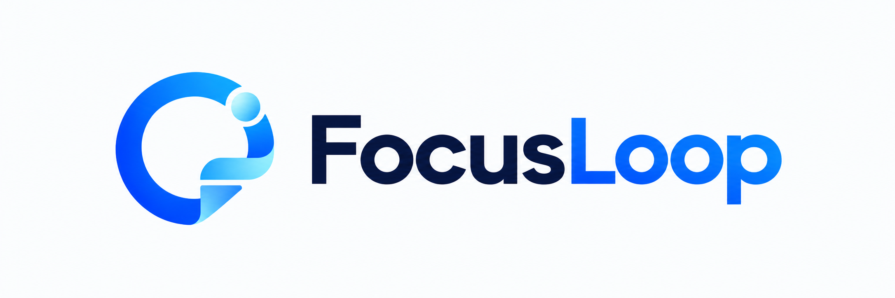
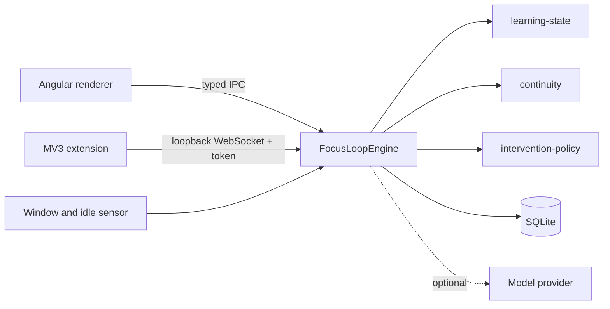

<p align="center">
  <picture>
    <source media="(prefers-color-scheme: dark)" srcset="docs/assets/logo_name_dark.png" />
    <source media="(prefers-color-scheme: light)" srcset="docs/assets/logo_name_light.png" />
    
  </picture>
</p>

<p align="center"><a href="README.md">English</a> · <b>简体中文</b></p>

# FocusLoop

**回到你刚才思考的地方。** 一个本地优先的桌面智能体,帮助注意力和任务启动困难的人在学习被打断后快速接续。

[安装](#安装) · [快速开始](#快速开始) · [工作原理](#工作原理) · [文档](#文档) · [参与贡献](#参与贡献)

> v0.1 演示版 · Electron + Angular 桌面端 · 可选 MV3 浏览器扩展 · 所有数据都留在你的电脑上。

FocusLoop **不做 ADHD 诊断**,也不评估临床严重程度。它只观察「学习交互」:开始了吗?还在吗?思路停在哪?被打断后,它不会催你"保持专注",而是给你一张 **接续卡(Resume Card)**:刚才在做什么、已完成什么、还有什么未解决、下一步是什么。

## 功能

- **微任务**:把课程或你自己的 `.txt` / `.md` 笔记拆成 3–5 个、每个几分钟的小任务。
- **专注会话与实时检查点**:持续保存当前概念、目标、已掌握内容、未解决问题和下一步最佳行动。
- **中断检测**:基于规则的 8 状态引擎识别窗口失焦或空闲;你离开期间不会弹出任何提示。
- **接续卡**:回来时展示你离开时的精确认知位置,并记录恢复耗时以及这次提示是否有帮助。
- **洞察与仪表盘**:按学习状态统计时间、每日活跃度、分课程明细、中断次数、恢复耗时与干预效果,可按本次会话、今天、7 天或全部时间查看。
- **自带模型,或不用模型**:默认使用确定性的 mock 提供方,完全离线运行;也可选用 DeepSeek、OpenAI 或任意 OpenAI 兼容接口。
- **双语与主题**:支持英文和简体中文;浅色、深色或跟随系统。

## 安装

从 [Releases 页面](https://github.com/nianpingy-cpu/focusloop/releases) 下载 `FocusLoop-Setup.exe`(请用 `SHA256SUMS.txt` 校验)。无需安装 Node.js 或 pnpm。macOS 等其他构建方式见[开发指南](docs/development.md#package)(英文)。

## 快速开始

从源码运行(Node.js ≥ 22.13,pnpm ≥ 9):

```bash
corepack enable
pnpm install
pnpm --filter @focusloop/desktop run start
```

然后体验一次完整闭环:**Home** → 在「Red-black trees: the basics」上点 _Start session_ → 完成第一个微任务 → 切换到其他窗口约 20 秒 → 回来看到接续卡。

不需要扩展、API Key 或网络。运行、打包、启动脚本和模型配置见[开发指南](docs/development.md)(英文)。

## 工作原理



四条不变量:

1. **本地优先。** 没有必需的服务器;完整主流程无需网络和密钥即可运行。
2. **状态引擎是领域模型,不是提示词。** `learning-state` 是纯函数 reducer,没有时钟、IO 或 LLM,并有穷尽的单元测试。
3. **渲染进程被隔离。** 启用 `contextIsolation` 与 `sandbox`,禁用 Node 集成,IPC 通道白名单封闭,并重新校验每个参数。
4. **隐私由权限模型保证。** 扩展不申请任何页面访问权限,因此无法读取 URL、标题、页面文本、表单输入或 Cookie。

| 路径        | 内容                                                                                                                                                 |
| ----------- | ---------------------------------------------------------------------------------------------------------------------------------------------------- |
| `apps/`     | `desktop`(Electron + Angular)、`desktop-e2e`(Playwright)、`extension`(Chrome/Edge MV3)                                                               |
| `packages/` | `shared-types`、`learning-state`、`continuity`、`intervention-policy`、`material-parser`、`agent-core`、`persistence`、`llm-provider`、`agent-evals` |

## 隐私

无账号,无遥测、分析或崩溃上报。数据存放在操作系统用户数据目录下的本地 SQLite 数据库。浏览器桥只绑定 `127.0.0.1`,需要每次运行的令牌,且只接受经过严格校验的元数据。导入的资料绝不上传。完整声明见 [docs/privacy.md](docs/privacy.md)(英文)。

**v0.1 不包含:** 诊断、摄像头/眼动/麦克风、移动端、账号、中心服务器、协作、强化学习。

## 文档

以下文档目前为英文。

| 主题                       | 位置                                           |
| -------------------------- | ---------------------------------------------- |
| 运行、打包、模型配置、检查 | [docs/development.md](docs/development.md)     |
| 架构                       | [docs/architecture.md](docs/architecture.md)   |
| LLM 提供方                 | [docs/llm-providers.md](docs/llm-providers.md) |
| 测试策略                   | [docs/testing.md](docs/testing.md)             |
| 隐私                       | [docs/privacy.md](docs/privacy.md)             |
| 发布                       | [docs/publishing.md](docs/publishing.md)       |
| 能力规划与决策             | [docs/wiki/README.md](docs/wiki/README.md)     |
| 变更记录                   | [CHANGELOG.md](CHANGELOG.md)                   |

## 路线图

- **v0.1**:桌面端、学习状态、检查点、接续、干预效果、仪表盘、桥接、打包。
- **v0.2**:PDF 导入、更丰富的资料解析、按概念的掌握度模型。
- **v0.3**:用户可调阈值、本地数据导入导出。
- **之后**:更多模型提供方;可选且需明确开启的同步。

## 参与贡献

请阅读 [CONTRIBUTING.md](CONTRIBUTING.md):一个 issue 一个分支,RED → GREEN → REFACTOR,不直接推送到 `main`,合并前需独立评审。

## 许可证

MIT,见 [LICENSE](LICENSE)。
